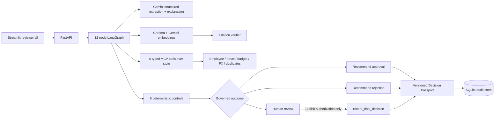

# ControlLedger AI

ControlLedger is a continuous expense-controls and audit-evidence platform. It converts policy into executable controls, checks employee claims with deterministic financial rules, uses AI for receipt understanding and evidence-grounded explanations, routes exceptions through governed outcomes, and creates a versioned **Decision Passport** for every claim.

This repository is an interview-scale MVP built with synthetic data. It is not an autonomous reimbursement system and contains no real employee, client, or financial data.

## Verified results

The committed 30-claim labeled portfolio currently produces:

| Metric | Result |
|---|---:|
| Workflow completion | **30/30 (100%)** |
| Versioned Decision Passports | **30/30** |
| Labeled routing accuracy | **30/30 (100%)** |
| Citation correctness when policy evidence exists | **28/28 (100%)** |
| Deliberate missing-policy cases safely routed to review | **2/2** |
| Governed outcomes exercised | **3/3** |
| Unauthorized write actions | **0** |
| LangGraph nodes | **12** |
| Typed MCP tools | **6** |
| MCP protocol calls in the evaluation | **132** |
| Deterministic financial controls | **6** |

The machine-readable run is in [outputs/evaluation_results.json](outputs/evaluation_results.json). Reproduce it with `make evaluate`.

## Where the AI is

The Gemini integration is a bounded service, not the final decision-maker:

- **Receipt understanding:** `gemini-3.1-flash-lite` extracts typed fields from receipt text or JPEG/PNG/WebP images.
- **Grounded explanation:** the model explains control results using only retrieved policy clauses and executed control evidence. Returned clause IDs are validated against retrieved evidence.
- **Policy-to-control drafting:** the model converts explicit policy thresholds into typed draft controls. Drafts are stored as `requires_human_approval` and cannot activate themselves.
- **Semantic retrieval:** `gemini-embedding-2` creates the embeddings used by the active Chroma policy index.
- **Safe fallback:** local development can run without a key using clearly labeled deterministic extraction, explanation, and local hash embeddings. Set `CONTROLLEDGER_AI_MODE=required` to fail startup rather than fall back.

Arithmetic, duplicate matching, thresholds, routing constraints, authorization, and the final write action stay in deterministic Python. Every AI call records its provider, operation, model, response ID, latency, token usage, and estimated cost in the claim evidence and Decision Passport. Cost rates are explicit environment settings so they can be updated without a code change.

## What is implemented

- FastAPI endpoints for claims, evidence, passport history, review, policies, AI control drafts, simulations, analytics, health, and readiness.
- A 12-node LangGraph workflow with conditional approval, rejection, and human-review routing.
- An `enterprise_context_server` using the official MCP Python SDK over real stdio transport.
- Five typed read tools and one explicitly human-gated write tool.
- Chroma retrieval with version filtering, Gemini embeddings when configured, citation verification, and a local no-key fallback.
- Six deterministic Python controls: amount match, allowance, duplicate/split detection, travel approval, travel dates, and FX variance.
- Structured AI outputs, prompt-injection detection, tool allowlisting, call limits, safety fallbacks, and complete audit evidence.
- Append-only JSON Decision Passport revisions containing hashes, policy evidence, MCP calls, AI calls, controls, reviewer state, and workflow trace.
- A two-scenario policy-impact simulator.
- A clean Streamlit interface for submission, receipt upload, work queue, evidence, approval/override, analytics, and simulation.
- Thirty synthetic labeled claims spanning three policy documents and every governed outcome.

## Architecture



RAG answers “what does the governing policy say?” MCP supplies structured enterprise context. Deterministic controls calculate compliance. LangGraph makes routing, safety fallback, and human review explicit.

## Run locally

Python 3.12 or newer is required.

```bash
python3 -m venv .venv
.venv/bin/pip install -e '.[dev]'
cp .env.example .env
set -a; source .env; set +a
```

Export the variables before starting the processes. To use live AI, create a key in
[Google AI Studio](https://aistudio.google.com/apikey), add it locally, and never commit it:

```bash
export GEMINI_API_KEY='your-key'
export CONTROLLEDGER_AI_MODE=required
```

Seed the demo and start the API:

```bash
.venv/bin/python scripts/seed_demo.py
.venv/bin/uvicorn backend.main:app --reload
```

In a second terminal, start the dashboard:

```bash
.venv/bin/streamlit run dashboard/app.py
```

Open the dashboard at `http://localhost:8501` and API documentation at `http://localhost:8000/docs`. `GET /ready` shows whether live AI is enabled, which models are configured, which RAG backend is active, and whether MCP uses stdio.

## API

| Area | Endpoints |
|---|---|
| Claims | `POST /claims`, `GET /claims`, `GET /claims/{id}`, `GET /claims/{id}/status` |
| Evidence | `GET /claims/{id}/evidence`, `GET /claims/{id}/decision-passport`, `GET /claims/{id}/decision-passport/revisions` |
| Human review | `POST /claims/{id}/review` |
| Policies | `POST /policies`, `GET /policies`, `GET /policies/{id}`, `POST /policies/{id}/activate` |
| AI control drafts | `POST /policies/{id}/draft-controls`, `GET /policies/control-drafts/{id}`, `POST /policies/control-drafts/{id}/approve` |
| Simulator | `POST /simulations`, `GET /simulations/{id}` |
| Analytics | `GET /analytics/controls`, `GET /analytics/exceptions` |
| Operations | `GET /health`, `GET /ready` |

Example claim submission:

```bash
curl -X POST http://localhost:8000/claims \
  -H 'content-type: application/json' \
  -d '{
    "employee_id":"E001",
    "merchant":"Green Table",
    "expense_date":"2026-09-21",
    "amount":850,
    "currency":"INR",
    "category":"meals",
    "cost_center":"CC100",
    "receipt_text":"GREEN TABLE\\nDate: 2026-09-21\\nTotal: INR 850.00"
  }'
```

The only financial write boundary is `record_final_decision`. Calls without `explicit_authorization: true` fail. A recommendation never executes a reimbursement or silently records a final decision.

## Workflow

The graph has these 12 nodes:

1. `validate_input`
2. `extract_receipt`
3. `detect_untrusted_instructions`
4. `retrieve_policy`
5. `fetch_enterprise_context`
6. `run_deterministic_controls`
7. `generate_risk_assessment`
8. `verify_citations`
9. `route_decision`
10. `human_review`
11. `persist_decision`
12. `generate_decision_passport`

Missing context, low extraction confidence, untrusted instructions, high-risk employees, insufficient budget, invalid citations, and unsupported categories all fail closed to human review.

## Test and evaluate

```bash
make lint
make test
make evaluate
```

With `GEMINI_API_KEY` set, verify all four live model paths:

```bash
make ai-smoke
```

The test suite covers structured AI responses, embeddings, policy-control drafting, all six controls, the real MCP stdio path, all six MCP tools, the write authorization gate, API submission and review, append-only passport revisions, three-way routing, citation verification, prompt injection, and missing enterprise context. The committed evaluation is reproducible without network access; its AI metadata honestly identifies the offline fallback. `make ai-smoke` is the separate live-provider verification.

## Deployment

`Dockerfile` and `render.yaml` define the Render API deployment, including required live-AI settings and Render's dynamic port. On an empty ephemeral filesystem, the container recreates the 30 synthetic demo claims in offline mode before starting the API in required live-Gemini mode. The Streamlit frontend is configured for Streamlit Community Cloud with `dashboard/app.py` as its entrypoint and `CONTROLLEDGER_API_URL` pointing to the Render API.

## Repository map

```text
backend/      FastAPI, LangGraph, MCP, AI, RAG, controls, persistence, passports
dashboard/    Minimal Streamlit reviewer interface
data/         Policies, YAML controls, enterprise fixtures, 30 labeled claims
scripts/      Demo seeding, live-AI smoke check, and repeatable evaluation
tests/        AI, MCP transport, controls, workflow, safety, citations, and API tests
outputs/      Verified evaluation artifact
```

## Known limitations

- Synthetic organization and enterprise fixtures only.
- Live Gemini execution requires the operator's API key; no secret is embedded in the repository.
- Gemini free-tier requests may be used by Google to improve its products, so this MVP uses synthetic data only.
- Small policy corpus and one active policy version at a time.
- SQLite and synchronous processing are appropriate for the MVP, not production scale.
- No authentication, enterprise RBAC, real ERP integration, reimbursement execution, or production multitenancy.

Production evolution would add PostgreSQL/pgvector, enterprise identity, durable queues, approved ERP/travel MCP adapters, tenant isolation, regional data controls, policy release workflows, and continuous evaluation monitoring.
